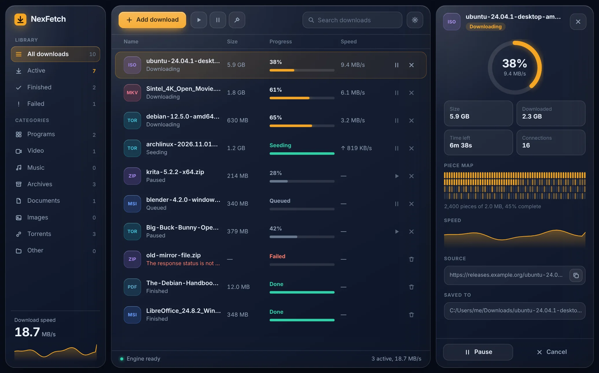

<p align="center">
  
</p>

<h1 align="center">NexFetch</h1>

<p align="center">
  A free, open-source download manager for Windows.<br />
  Fast downloads, torrents and magnet links, and a browser extension. No ads, no tracking.
</p>

<p align="center">
  <a href="https://github.com/Heisenberg-X1/NexFetch/releases/latest"></a>
  <a href="LICENSE"></a>
  
</p>

<p align="center">
  <a href="https://heisenberg-x1.github.io/NexFetch/">Website</a> |
  <a href="https://github.com/Heisenberg-X1/NexFetch/releases/latest">Download</a> |
  <a href="https://github.com/Heisenberg-X1/NexFetch/issues">Report a problem</a>
</p>



## Features

- **Fast downloads.** Every file is split into up to 16 connections. Downloads resume after interruptions.
- **Torrents and magnet links.** Add a magnet link or a `.torrent` file, pick which files you want, and see seeds, peers, upload speed and share ratio. Seeding is off by default.
- **Browser extension.** Catches downloads in Chrome, Edge, Brave, Opera and Firefox and sends them to NexFetch. Right-click any link, video or audio to send it manually. Optional cookie sharing for sites where you have to be signed in.
- **Details panel.** Click a download for a progress ring, speed over time, a map of which pieces are done, the source link and the save path.
- **Easy to manage.** Search, sort by name, size or progress, and filter by status or category (programs, video, music, archives, documents, images, torrents).
- **Your limits.** Choose how many downloads run at once, cap the speed and set the number of connections per file.
- **Looks good.** Glass interface in light, dark or automatic, with five accent colors. Animations switch off if your system asks for reduced motion.
- **Handy shortcuts.** Press Ctrl+V with a link copied to add it, Ctrl+N to add, Ctrl+F to search, arrow keys to move through the list, Esc to close.
- **No ads, no accounts, no analytics.** The only network traffic is the downloads you start.

## Install

1. Download the file ending in `-setup.exe` from the [latest release](https://github.com/Heisenberg-X1/NexFetch/releases/latest).
2. Run it. Windows may show "Windows protected your PC". Click **More info**, then **Run anyway**. NexFetch is not code-signed yet.
3. Optional: set NexFetch as the default app for `magnet` links and `.torrent` files in Windows Settings, Apps, Default apps.

Requires Windows 10 or 11, 64-bit. If Windows Smart App Control is turned on, it blocks every unsigned app. Turn it off in Windows Security, App and browser control, to run NexFetch.

## Browser extension

The extension lives in [`extension/`](extension). Use `extension/chromium` for Chrome, Edge, Brave, Opera and Vivaldi, and `extension/firefox` for Firefox.

1. Open your browser's extensions page, turn on developer mode and load the folder (in Firefox, use `about:debugging` and load `manifest.json` as a temporary add-on).
2. In NexFetch, open **Settings** and press **Copy pairing code**.
3. In the extension's settings, paste the code and click **Connect**.

Full steps and limits are in [`extension/README.md`](extension/README.md). NexFetch has to be running. If it isn't, your browser keeps the download.

## Build from source

You need:

- Windows 10 or 11
- [Node.js](https://nodejs.org) (LTS)
- [Rust](https://rustup.rs) (stable)
- Microsoft C++ Build Tools with the "Desktop development with C++" workload
- The [aria2](https://github.com/aria2/aria2/releases) binary for Windows

```bash
git clone https://github.com/Heisenberg-X1/NexFetch.git
cd NexFetch
npm install
```

Put the aria2 binary in `src-tauri/binaries/` and name it exactly:

```
aria2c-x86_64-pc-windows-msvc.exe
```

Then run it or build the installer:

```bash
npm run tauri dev      # run in development
npm run tauri build    # build the installer
```

The installer is written to `src-tauri/target/release/bundle/nsis/`.

Notes:

- The first build compiles a lot of Rust code and takes several minutes. Later builds are much faster.
- `src-tauri/binaries/` is not committed to git. Download aria2 yourself, as above.
- Torrent and magnet-link handling only works in an installed build, because Windows has to register NexFetch for them. It does not work under `npm run tauri dev`.

## How it works

- **Interface:** plain HTML, CSS and JavaScript with no frameworks and no build step, in `src/`.
- **App shell:** [Tauri](https://tauri.app) (Rust), in `src-tauri/`. It starts aria2 as a sidecar, keeps one copy of the app running, and passes magnet links and `.torrent` files to the window.
- **Download engine:** [aria2](https://github.com/aria2/aria2), controlled over its JSON-RPC interface. It listens on `127.0.0.1` only and needs a secret key.
- **Browser extension:** talks to the same aria2 interface on your own computer, using a pairing code you copy from NexFetch once.

```
NexFetch/
  src/            interface (HTML, CSS, JavaScript)
  src-tauri/      Rust app shell and Tauri config
  extension/      browser extension (chromium and firefox)
  docs/           the website (GitHub Pages)
```

## Troubleshooting

| Problem | What to try |
| --- | --- |
| "Engine not running" | Close NexFetch completely and open it again. If it keeps happening, reinstall. |
| Windows blocks the installer | Click More info, then Run anyway. If there is no such button, turn off Smart App Control. |
| Magnet links open another app | Set NexFetch for `magnet` in Windows Settings, Apps, Default apps. |
| The extension can't connect | Make sure NexFetch is open, then copy a fresh pairing code from its Settings. |
| A download fails with 403 | The site wants you signed in. Install the extension and turn on cookie sharing. |

Still stuck? [Open an issue](https://github.com/Heisenberg-X1/NexFetch/issues/new) with your Windows version, the NexFetch version, what you did and what happened. A screenshot helps.

## Roadmap

No dates and no promises:

- [ ] Scheduler and download queues
- [ ] Video downloads from streaming pages (HLS and DASH)
- [ ] Code-signed installer and automatic updates
- [ ] macOS and Linux builds
- [ ] Open a finished file or its folder from the list

## Contributing

Bug reports, ideas and pull requests are welcome. Please open an issue first for bigger changes so we can talk it through. Keep changes small and focused, and test them in a real build of the app when you can.

## License

NexFetch is licensed under the [GNU General Public License v3.0](LICENSE).

It is built on free software:

- [aria2](https://github.com/aria2/aria2) (GPL-2.0-or-later) is the download engine. NexFetch runs it as a separate program and does not modify it.
- [Tauri](https://tauri.app) (MIT or Apache-2.0) is the app framework.

NexFetch is an independent project and is not affiliated with or endorsed by aria2 or Tauri.
